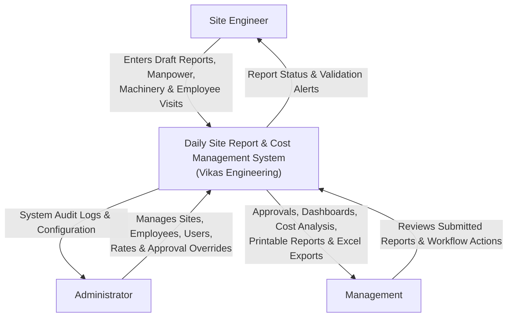
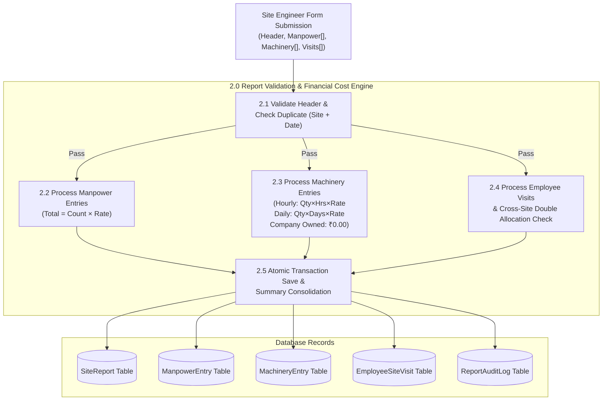

# Daily Site Report & Cost Management System
**Vikas Engineering & Infrastructure**

A responsive, production-ready web application built with **Python Django**, **PostgreSQL / SQLite**, **HTML5/CSS3/JavaScript**, and **Bootstrap 5** for daily construction-site reporting, dynamic manpower tracking, machinery utilization, employee site visits, and automated real-time financial costing.

---

## 1. System Architecture & Data Flow Diagrams (DFD)

### DFD Level 0: Context Diagram


### DFD Level 1: Functional Decomposition Diagram
```mermaid
flowchart TD
    User["Authenticated User\n(Engineer / Admin / Management)"]

    subgraph CoreSystem["Daily Site Report & Cost Management System"]
        P1["1.0 Authentication &\nRole-Based Access Control"]
        P2["2.0 Daily Site Report\nBuilder & Dynamic Rows"]
        P3["3.0 Financial Cost Calculation\n& Validation Engine"]
        P4["4.0 Approval & Correction\nWorkflow Engine"]
        P5["5.0 Analytics Dashboard &\nCost Comparison"]
        P6["6.0 Multi-Sheet Excel &\nPrint Report Generator"]
    end

    subgraph DataStores["Database (PostgreSQL)"]
        D1[("User & Role Profiles")]
        D2[("Master Data\n(Sites, Employees, Rates)")]
        D3[("Site Reports & Child Entries\n(Manpower, Machinery, Visits)")]
        D4[("Audit Trail Logs")]
    end

    User -->|Credentials| P1
    P1 <--> D1

    User -->|Daily Report Data| P2
    P2 <--> D2
    P2 -->|Entries| P3
    P3 -->|Validated Totals| D3

    P4 <--> D3
    P4 -->|State Transitions| D4

    D3 -->|Aggregated Data| P5
    P5 -->|Charts & KPI Cards| User

    D3 -->|Raw & Filtered Records| P6
    P6 -->|Excel (.xlsx) & Printable PDF| User
```

### DFD Level 2: Daily Site Report & Financial Cost Processing


---

## 2. Business Rules & Financial Formulas

1. **Duplicate Report Prevention**:
   - Only one report is allowed per `(site, report_date)` combination.
   - If an Administrator explicitly toggles `allow_duplicate = True`, duplicate submissions for distinct shifts or subcontractors are accepted.

2. **Manpower Calculation**:
   - `Total Manpower Cost = Σ (Worker Count × Rate per Head)`
   - Categories: `Labour`, `Mason`, `Painter`, `Other Contractor`
   - Types: `Permanent`, `Chowk`, `Contractor`, `Other`

3. **Machinery Calculation**:
   - **Rental Machinery**:
     - Hourly: `Rental Cost = Quantity × Usage Hours × Hourly Rate`
     - Daily: `Rental Cost = Quantity × Usage Days × Daily Rate`
   - **Company Owned Machinery**:
     - `Rental Cost = ₹0.00` (defaults to zero so clients/projects are not double-billed). Optional internal costs are tracked independently.

4. **Employee Site Visit Costing & Anti-Double Counting Rule**:
   - Master daily and hourly rates are snapshotted into `applied_rate` upon report submission so historical figures remain immutable if master rates change later.
   - **Full Day**: `Allocated Cost = Applied Rate (Daily Rate)`
   - **Half Day**: `Allocated Cost = 0.5 × Applied Rate (Daily Rate)`
   - **Hourly**: `Allocated Cost = Hours Spent × Applied Rate (Hourly Rate)`
   - **No Cost**: `Allocated Cost = ₹0.00`
   - **Double-Counting Prevention**: Validates that an employee is not allocated more than 1.0 day across multiple sites on the same reporting date (e.g. cannot be billed for two Full Days, or more than two Half Days).

5. **Site Cost Summary (Today)**:
   - `Total Site Cost = Manpower Cost + Rental Machinery Cost + Employee Site Visit Cost`
   - Live JavaScript updates calculate immediate totals across all sections.
   - Backend database transactions recalculate and validate all sums server-side.

6. **Workflow & Audit Logging**:
   - `Draft` → `Submitted` → `Approved` (or `Returned for Correction`)
   - Any return action captures required correction remarks for the Site Engineer.
   - All state transitions create timestamped `ReportAuditLog` records with the acting user's profile.

---

## 3. Technology Stack

- **Backend**: Python 3.10+ / Django 4.2 LTS
- **Database**: PostgreSQL (with automatic SQLite fallback for zero-dependency local dev)
- **Frontend**: HTML5, CSS3, JavaScript (ES6+), Bootstrap 5.3, Bootstrap Icons
- **Data Visualization**: Chart.js 4.4
- **Spreadsheet Generation**: openpyxl 3.1+
- **Static Assets**: WhiteNoise for compression and manifest caching
- **Timezone**: India Standard Time (`Asia/Kolkata`)

---

## 4. Setup & Installation Guide

### Prerequisites
- Python 3.10 or higher
- PostgreSQL (optional for local testing; default SQLite database works out-of-the-box)

### Step 1: Clone or Navigate to Project Directory
```powershell
cd "c:\Vikas Eng"
```

### Step 2: Install Dependencies
```powershell
pip install -r requirements.txt
```
*(Packages include: `Django`, `psycopg2-binary`, `openpyxl`, `whitenoise`, `python-decouple`)*

### Step 3: Configure Environment Variables
Copy `.env.example` to `.env`:
```powershell
Copy-Item .env.example .env
```

To configure PostgreSQL, update `.env`:
```ini
DB_ENGINE=django.db.backends.postgresql
POSTGRES_DB=vikas_eng_db
POSTGRES_USER=postgres
POSTGRES_PASSWORD=your_password
POSTGRES_HOST=localhost
POSTGRES_PORT=5432
```
If PostgreSQL is not running locally, simply leave `DB_ENGINE` empty to use the pre-configured local SQLite database.

### Step 4: Apply Database Migrations
```powershell
python manage.py migrate
```

### Step 5: Populate Demo Construction Sites, Employees & Reports
Run the built-in demo seeder to establish users, sites, rates, and historical reports:
```powershell
python manage.py setup_demo_data
```

### Step 6: Collect Static Files
```powershell
python manage.py collectstatic --noinput
```

### Step 7: Launch Development Server
```powershell
python manage.py runserver 0.0.0.0:8000
```
Open your browser at: **`http://localhost:8000`**

---

## 5. Default Demo Credentials

| Role | Username | Password | Permissions |
|---|---|---|---|
| **Administrator** | `admin` | `admin123` | Full access: Sites, Employees, Users, Approvals, Overrides |
| **Site Engineer** | `engineer` | `engineer123` | Create/edit draft reports, log manpower & machinery, submit reports |
| **Management** | `manager` | `manager123` | View dashboard KPIs, approve reports, return reports, export Excel |

*(Quick credentials auto-fill buttons are provided directly on the Login page for rapid evaluation.)*

---

## 6. Running the Automated Test Suite

The comprehensive test suite verifies hourly/daily machinery calculations, manpower multiples, employee visit allocation, duplicate report prevention, anti-double-counting constraints, and role permissions:

```powershell
python manage.py test reports
```
Expected output:
```
Found 14 test(s).
System check identified no issues (0 silenced).
..............
Ran 14 tests in 32.734s
OK
```

---

## 7. Production Deployment Instructions

### Option A: Gunicorn + Nginx + PostgreSQL (Linux VM)
1. **Gunicorn Systemd Service** (`/etc/systemd/system/vikas_eng.service`):
```ini
[Unit]
Description=Gunicorn daemon for Vikas Engineering Daily Site Report
After=network.target

[Service]
User=www-data
Group=www-data
WorkingDirectory=/var/www/vikas_eng
ExecStart=/var/www/vikas_eng/venv/bin/gunicorn --access-logfile - --workers 3 --bind unix:/run/vikas_eng.sock config.wsgi:application
Restart=always

[Install]
WantedBy=multi-user.target
```

2. **Nginx Configuration** (`/etc/nginx/sites-available/vikas_eng`):
```nginx
server {
    listen 80;
    server_name reports.vikaseng.com;

    location = /favicon.ico { access_log off; log_not_found off; }
    location /static/ {
        alias /var/www/vikas_eng/staticfiles/;
        expires 30d;
        add_header Cache-Control "public, max-age=2592000";
    }

    location / {
        include proxy_params;
        proxy_pass http://unix:/run/vikas_eng.sock;
    }
}
```

3. **Security Checklist for Production**:
- Set `DEBUG=False` in `.env`.
- Set unique, cryptographically random `SECRET_KEY`.
- Set `ALLOWED_HOSTS=reports.vikaseng.com,your-domain.com`.
- Enable SSL/TLS using Let's Encrypt Certbot: `sudo certbot --nginx -d reports.vikaseng.com`.
- Configure automated PostgreSQL backups with `pg_dump`.

---

## 8. Employee Cash & Expense Management System

### Modules & Capabilities:
- **Cash In Management**: Record company, bank, and ATM cash infusions per employee.
- **Site Expense Management**: Record real-time site expenditures with allocation to site, category, and particulars.
- **Cash Out Management**: Record external payments to vendors and third parties.
- **Inter-Employee Transfers**: Atomic double-entry transfer (Sender Debit, Receiver Credit) with zero net company expense.
- **Running Ledger Calculation**: Automatic chronological running balance recalculation.
- **Excel Data Migration**: Built-in command `python manage.py import_emp_exp_excel` migrating all historical sheets from `EMP EXP 26-27.xlsx`.
- **Excel Exports**: Professional `.xlsx` exports for individual staff ledgers and company-wide expenses.

